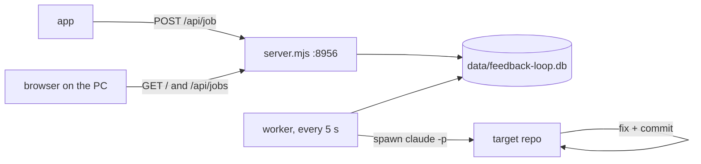

# Feedback Loop: how it is built

One Node process, `server.mjs`, on 127.0.0.1:8956: a `node:http` server, a `node:sqlite` queue and an in-process worker on a 5 s timer that spawns the Claude Code CLI one job at a time. No dependencies, no build. <!-- src: server.mjs:1-7, server.mjs:18, server.mjs:129, server.mjs:294 -->

## Components

- `server.mjs`: env loading, the SQLite schema, the worker (`tick`), the HTML renderer (`renderJobs`) and the router (`route`). <!-- src: server.mjs:9-16, server.mjs:38-51, server.mjs:68-127, server.mjs:146-170, server.mjs:250-292 -->
- `feedback-loop.service`: systemd user unit, `Restart=always`. <!-- src: feedback-loop.service -->
- `setup.sh`: first-run installer for `.env` and the unit. <!-- src: setup.sh -->
- `.github/workflows/ci.yml`: syntax check and smoke run on push to main and on PRs. <!-- src: .github/workflows/ci.yml -->

## Data flow

- `POST /api/job`: parse the JSON body, check the secret, require `title`, `description` and `repo`, refuse at 30 pending or running, insert a `pending` row and return its id. <!-- src: server.mjs:265-281 -->
- Worker: when idle, take the oldest `pending` row, mark it `running`, resolve `repo` (`~` to `HOME`, relative to the server folder), fail it if the path is missing, otherwise spawn `claude` with the prompt in that directory. <!-- src: server.mjs:68-102, server.mjs:55-60 -->
- On exit: code 0 marks it `completed` with the `session_id` parsed from stdout and up to 8000 chars of stdout; anything else marks it `failed` with up to 2000 chars of stderr. A spawn error also fails it. <!-- src: server.mjs:108-126 -->
- Status: `GET /api/jobs` returns the last 30 jobs as an HTML fragment; `GET /` returns the page shell. <!-- src: server.mjs:146-170, server.mjs:255-262, server.mjs:283-288 -->

## Storage

- `data/feedback-loop.db`, SQLite in WAL mode, created beside `server.mjs`, gitignored. One table, `jobs`: id, kind (bug or error), title, description, repo_path, source, status (pending, running, completed, failed), session_id, result, error, created_at, updated_at (UTC). <!-- src: server.mjs:35-51, .gitignore -->
- `.env` beside `server.mjs`, gitignored. <!-- src: server.mjs:10-16, .gitignore -->

## Auth

- `POST /api/job` needs `secret` in the body to equal `FEEDBACK_LOOP_SECRET`, compared with `timingSafeEqual`. `GET /` and `GET /api/jobs` have no auth: the 127.0.0.1 bind is the only gate. <!-- src: server.mjs:243-248, server.mjs:255-288, server.mjs:294 -->

## External services

- Claude Code CLI (`CLAUDE_PATH`, default `claude`), spawned per job; it does its own network calls and auth. The server makes no network requests itself. <!-- src: server.mjs:22, server.mjs:98-102, SECURITY.md:12 -->

## Unverified

None.
